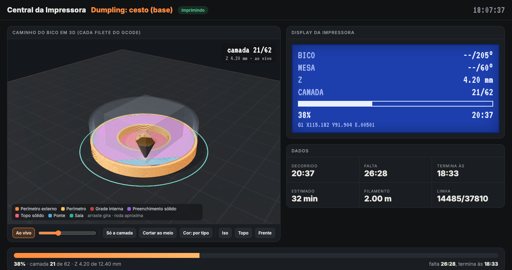

# impressora-3d

Setup para operar uma impressora 3D Creality Ender-3 pelo USB do Mac com um agente de IA (Claude Code)
como operador: envio de G-code, fatiamento, câmeras com zoom no bico, voz em português e uma central
web que mostra a impressão em 3D, filete por filete.



## O que tem aqui

| Parte | Arquivos | Função |
|-------|----------|--------|
| Envio | `imprime.py`, `cmd.py`, `prog.sh` | Envia o `.gcode` linha a linha pela serial e grava o progresso, o log e as temperaturas. |
| Calibração | `nivel.py`, `ext.py` | Leva o bico aos cantos para nivelar com papel; testa o extrusor. |
| Fatiamento | `ender3_pla.ini` | Perfil do PrusaSlicer para Ender-3 com PLA. |
| G-code sem fatiador | `gera_teste.py`, `gera_cachorro.py` | Peças de teste geradas direto em Python. |
| Câmeras | `zoom.py`, `cam2/`, `painel.py`, `vigia.py` | iPhone pela Continuity Camera, segundo iPhone por página HTTPS local, painel com detecção YOLO, aviso de mudança de cena. |
| Voz | `falar.py`, `ouvir.py`, `parar.sh` | Fala em pt-BR pelo Fish Audio; microfone com whisper local. |
| Central web | `central/` | Caminho do bico em 3D, display no estilo do LCD, tempos, câmeras e fila de arquivos. |

## Requisitos

- macOS, impressora com Marlin (testado no firmware Creality 2.0.8.2) ligada por USB (CH340, driver nativo).
- Python 3 com `pyserial` para o envio; `opencv-python`, `numpy` e `ultralytics` para as câmeras.
- PrusaSlicer para fatiar (`brew install --cask prusaslicer`).
- Opcional: chave do Fish Audio em `~/.fish-audio/key` para a voz; `whisper-cli` para o microfone.

## Uso rápido

```bash
ls /dev/cu.usb*                                    # o nome da porta muda ao religar
export PORTA_IMPRESSORA=/dev/cu.usbserial-1140
python3 cmd.py "M105"                              # lê as temperaturas
/Applications/PrusaSlicer.app/Contents/MacOS/PrusaSlicer --load ender3_pla.ini \
  --center 110,110 --export-gcode -o peca.gcode modelo.stl
nohup python3 -u imprime.py peca.gcode > imprime.log 2>&1 &
python3 central/server.py                          # http://localhost:8090
```

Para a peça aparecer com nome e cor na central, cadastre o gcode em `central/modelos.json`.

## Cuidados

- Abrir a porta serial reinicia a placa (sinal DTR do CH340). Nunca abra a porta durante uma impressão.
- Os motores só andam com a fonte de 24 V ligada; só com o USB, o `G28` fica esperando para sempre.
- Rode o envio com `nohup`. Ferramentas com tempo limite matam o processo e a impressão para no meio.
- A central só lê arquivos e nunca toca na serial, então pode ser aberta e fechada a qualquer momento.

## Licença

MIT. Veja `LICENSE`.
